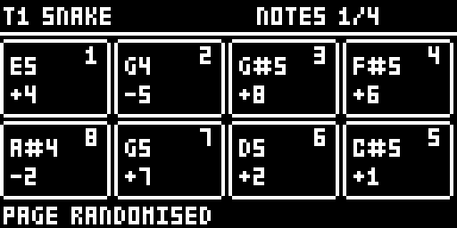
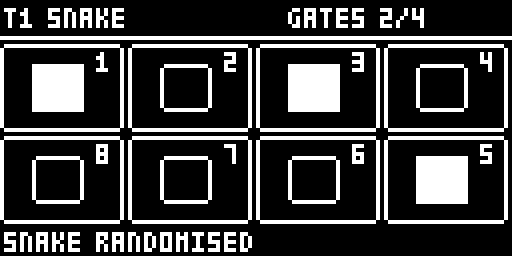

# DIGISNAKE for the Digitakt

DIGISNAKE on the **Elektron Digitakt mk1**, as an [elekloader](https://github.com/irpina/elekloader) mod
(id `digisnake-dt`): the same 4 × 2 snake as the Digitone's DIGISNAKE (see the [main README](../README.md)),
on all 8 audio tracks (a note is the sample's pitch, like a note lock) and the 8 MIDI tracks.

By Robbie (tested on a Digitakt mk1, OS 1.54). GPL-2.0-or-later.

> Unofficial and unsupported. Flashing modified firmware is at your own risk; the stock OS always
> recovers the unit (send the stock .syx from the boot menu).

  

## What you need

| | |
|---|---|
| Unit | Digitakt mk1 |
| OS | **1.54** (tested). A 1.53 build is included (run in an emulator, not on a unit) |
| Mods | elekloader's **core** (3.0 or later), built into the elekloader app, and **seq-events** (0.1) for the Digitakt, included here in `elemods/` |

## Install

In the elekloader app, add both files for your OS from `elemods/`: `digisnake-dt-0.2-os1.54.elemod` and
`seq-events-dt-0.1-os1.54.elemod` (or the two `-os1.53` files). Tick both, keep the app's core ticked,
build, and send the firmware to the Digitakt. From the command line:

```
python -m elekloader.patch --stock Digitakt_OS1.54.syx \
  --mod core-4.1-os1.54.elemod --mod elemods/seq-events-dt-0.1-os1.54.elemod \
  --mod elemods/digisnake-dt-0.2-os1.54.elemod --out Digitakt_digisnake.syx
```

It combines with other Digitakt mods (tested with PUMP-DT, DH-101, Digi Mono, digihealth, lostsplash and
machine-pages).

## Opening it

Press **TRIG** twice: the first press shows the TRIG page, the second opens Snake (however long it is held).
TRIG again goes back to the TRIG page; another page key goes to its page, and a menu opening over the pages
(GLOBAL, the pattern menu ...) closes it. Turn the track's **SNAKE** on (PATH page, knob A) and it plays the
snake in place of its own trigs; lock trigs still play.

The pages and keys are the Digitone's: NOTES, GATES, VELOCITY and PATH (LEFT / RIGHT); hold TRIG + YES
randomises a page, FUNC + YES all of them; TRIG + NO and FUNC + NO reload; TRIG + REC / STOP copy and paste a
page; TRIG + PLAY clears it; hold **TRIG + FUNC + REC** to PRINT the snake into the track's trigs, notes and
velocities (SNAKE then turns off). On the GATES page trig keys 1–8 toggle gates; hold TRK to select tracks
as usual.

## How it differs from the Digitone's

- **Not saved with the project.** The Digitakt's core has no project storage yet: the snakes reset on
  power-off and project load. PRINT keeps a sequence.
- **Its own page, drawn over the screen.** The Digitakt core cannot add a page to TRIG, so the Snake page is
  drawn over the TRIG page; short messages show on its bottom line instead of a drop-down.
- **No Mod Menu entry** (the Digitakt core has none).
- **Scales** are rooted on the track's NOTE (the Digitakt has no keyboard ROOT).
- **2X** works as on the Digitone: the pattern must be in per-track SCALE mode (FUNC + PAGE).

## Changes

- **0.2**: the 2X division; PRINT writes velocities.
- **0.1**: the first version, from DIGISNAKE 1.2.

## How it works

The sequencer side is the Digitone's: seq-events' step-fire events (`ev_gen_trig`, `ev_gen_notes`,
`ev_fire_vel`). The page reads the key dispatcher's screens (its brain, the first argument of each key
event) to know when the TRIG page is up, and draws over it from `ev_draw`. PRINT and 2X write the active
pattern: 911 bytes a track, its step words at +0, each step's VEL at +0x80 (255: the track's), note lock 1
at +0x280, the track's SCALE at +0x38b; the pattern pointer and the transport are the per-OS addresses
seq-events uses (`mod.json`'s cflags). The pattern offsets were measured in digiemu by changing a value on
the unit and comparing the pattern before and after.

## Building

With elekloader and an m68k cross GCC on the path:

```
python -m elekloader.sdk.build --stock Digitakt_OS1.54.syx .
```

## Credits

As the main README's. The two `elemods/seq-events-dt-0.1-*.elemod` files are unmodified builds of
elekloader's `mods/seq-events-dt1` (GPL-2.0-or-later, by elekloader's contributors), made from
[its source at commit b9006bf](https://github.com/irpina/elekloader/tree/b9006bf8b7c4e69becd7e2f16ec6b20ea52b8982/mods/seq-events-dt1); they carry
only that mod's own code and no Elektron code. Elektron and Digitakt are trademarks of Elektron Music
Machines; this project is not affiliated with or endorsed by Elektron.
